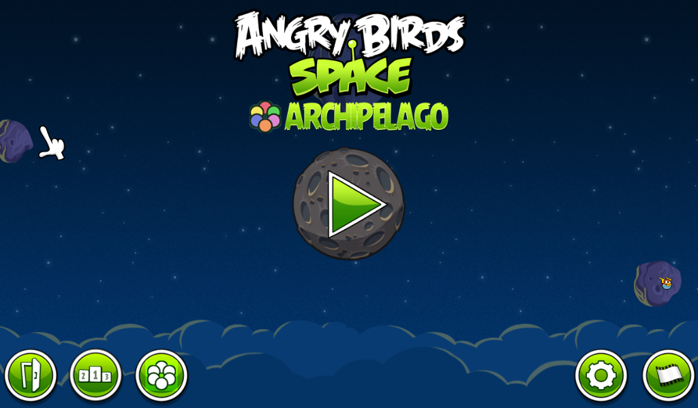
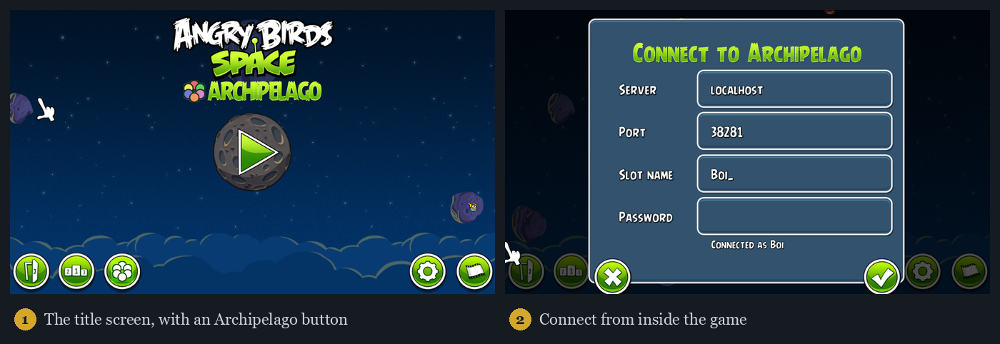
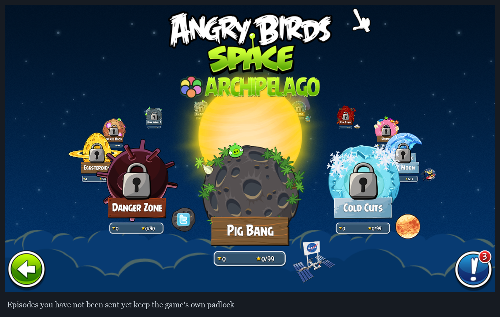
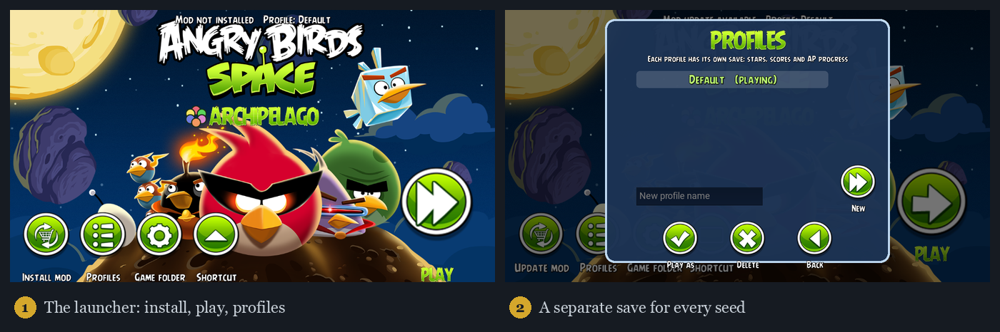

<p align="center">
  
</p>

<h1 align="center">Angry Birds Space Archipelago</h1>

<p align="center">
  An <a href="https://archipelago.gg">Archipelago</a> multiworld randomizer for the PC version of <b>Angry Birds Space</b>.<br>
  Episodes and birds are scattered across the multiworld, and everything happens inside the game.
</p>

---

## Features

### Everything inside the game

The title screen gets an **Archipelago** logo and a round Archipelago button next to the game's own buttons.
It opens a connect screen built from the game's dialog panel, fonts and buttons: type your server, port and
slot, press the check mark, done. The game remembers it and reconnects by itself next time.

The game can't open network connections, so a small helper (the Archipelago client) runs hidden in the
background while you play. You never see a window; it starts with the connect button and quits with the game.

<p align="center"></p>

- **Ctrl+V** pastes. Pasting `archipelago.gg:38281` into *Server* fills in the port too.
- **Space** types the dot in the server name (the game has no `.` key), **Shift** gives capitals and `_`.
- **Tab** / arrow keys or a click choose the field, **Enter** connects, **Esc** closes.

### Episodes and birds are the items

Every episode except Pig Bang starts locked. Each one is an item (*Cold Cuts Episode*, *Utopia Episode*, ...),
and so are the birds: a level can only be played once you have every bird it uses. You start with the
**Red Bird** and the **Blue Birds**; the **Lazer Bird**, **Firebomb Bird**, **Ice Bird**, **Big Brother Bird** and
**Globe Bird** are out in the multiworld.

Locked planets and levels keep the game's own padlocks. Click a locked level and the game tells you what it is
still missing, for example *"Needs: Ice Bird, Lazer Bird"*. Comics and the *Next* button can't sneak you into a
level you don't have yet either.

<p align="center"></p>

### Items arrive as in-game notifications

What you receive, what you send and what you find pops up in the game's own notification bar.
Filler items are real in-game rewards: **Space Eagles** and the **Space Egg**, **Flock of Birds** and
**Pig Puffer** power-ups.

### Checks

| Check | Count |
| --- | --- |
| Clearing a level (Pig Bang to Danger Zone, plus Eggsteroids) | 309 |
| *Episode* Complete, for clearing every level of an episode | 12 |
| Three-starring a level (optional) | 309 |

Only levels you clear while connected to a seed count, so an old save never gives away checks.

### Goals

- **Boss Rush**: defeat all 8 episode bosses.
- **Level Count**: clear a number of levels.
- **Star Hunt**: collect a number of stars (your best result on each level counts).

### Traps and DeathLink

- **Bird Swap Trap**: the pigs swap the bird on your slingshot for another kind from the same level.
- **DeathLink**: failing a level takes everyone down with you, and someone else's death kicks you back to the
  level selection.

### A launcher that looks like the game

**Angry Birds Space Launcher** (in the Archipelago Launcher) installs and updates the mod, starts the game and
manages **save profiles**: every seed can have its own save with its own stars and scores. It can also put a
shortcut on your desktop. Everything in it is drawn from your own game files.

<p align="center"></p>

---

## Setup

You need **Angry Birds Space for PC** (the Rovio PC release with `AngryBirdsSpace.exe`) and
**Archipelago 0.6.4 or newer**.

1. Download `angrybirdsspace.apworld` from the [releases](../../releases) and put it in Archipelago's
   `custom_worlds` folder.
2. Open the Archipelago Launcher and start **Angry Birds Space Launcher**.
   Set your game folder if it asks, then press **Install mod**. Your original files are kept in
   `<game folder>/ap_backup`, and *Game folder → Uninstall mod* puts them back.
3. Press **Play**, click the Archipelago button in the game and connect.

The standalone **Angry Birds Space Client** is still there if you want the server log and commands like `!hint`.

### Options

```yaml
Angry Birds Space:
  goal: boss_rush            # boss_rush | level_count | star_hunt
  levels_for_goal: 120       # level_count: 10-309
  stars_for_goal: 300        # star_hunt: 30-900
  three_star_checks: false   # three-starring a level is also a check
  include_eggsteroids: true  # Eggsteroids becomes a randomized episode
  trap_chance: 10            # % of filler that becomes Bird Swap Traps
  death_link: false
```

---

## How it works

- The game's scripts are Lua 5.1 bytecode inside AES-encrypted 7-Zip containers. The mod replaces
  `gamelogic.lua` with a tiny loader that runs the original and then [`game/ap.lua`](game/ap.lua), which hooks
  the game's own functions: level unlocking, the episode map, level-complete events, the main menu.
- Game → client: the game saves its AP state with its own save function (an encrypted file the client reads).
  Client → game: the client writes a plain Lua file next to the game that the game loads every half second.
- The title logo is rebuilt from your own copy of the game plus an overlay, and the connect screen, padlocks and
  notifications are the game's own assets. **This repository contains no game files.**

## Building

```
python tools/build.py              # builds build/angrybirdsspace.apworld
python tools/test_gamefiles.py     # self-checks: AES, PNG, logo atlas
python tools/test_profiles.py      # self-checks: save profiles
python tools/lua_check.py game/ap.lua
```

`tools/build.py` and the logo tools read the original `MENU_ELEMENTS_1.png/.dat` from
`backup/data/images/pc/` and the fonts from your game folder; copy them there from your own install first.
Building needs Python 3.12 with `cryptography`, `py7zr` and `Pillow`.

## Credits

- [Archipelago](https://archipelago.gg) and its community.
- [jooapa/Angry_Birds_Decompilation](https://github.com/jooapa/Angry_Birds_Decompilation) for the file format notes,
  and [unluac](https://sourceforge.net/projects/unluac/) for reading the game's scripts.

Angry Birds Space is © Rovio Entertainment. This is a fan project, not affiliated with or endorsed by Rovio.
You need your own copy of the game.
